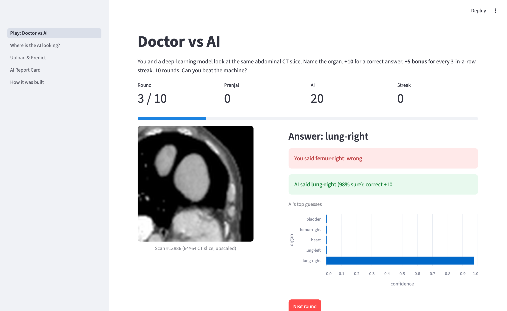
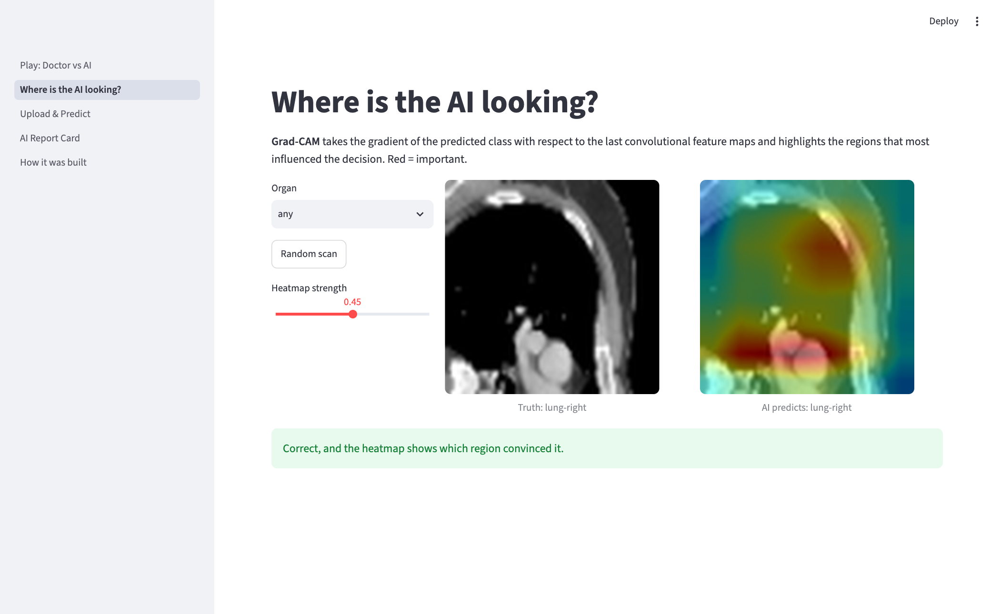
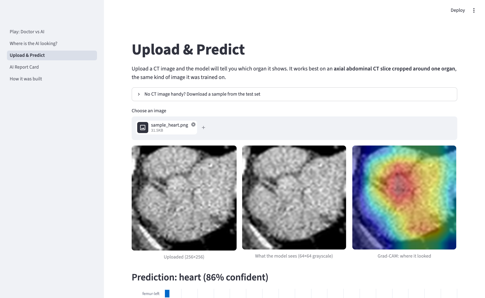
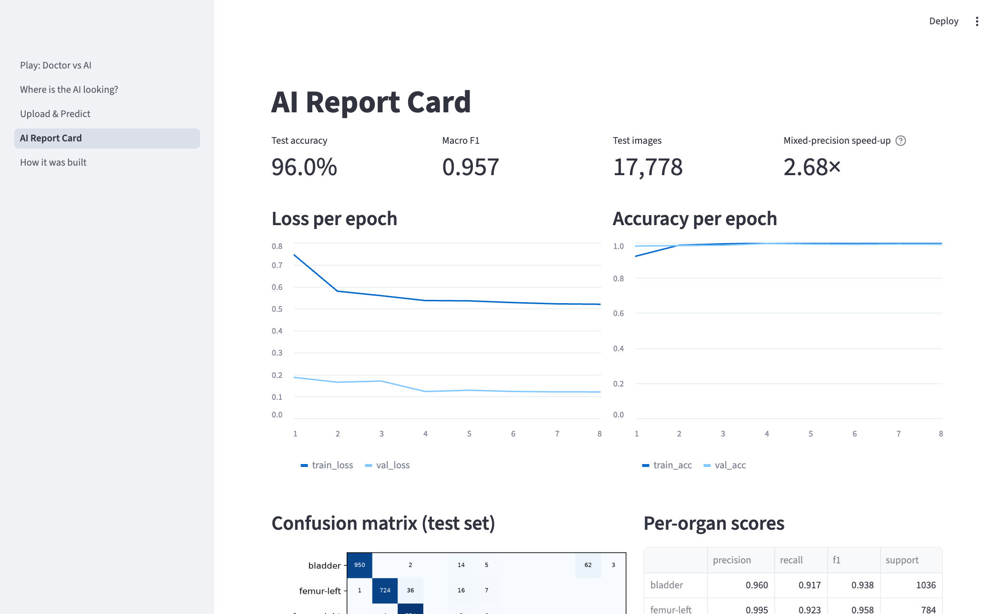
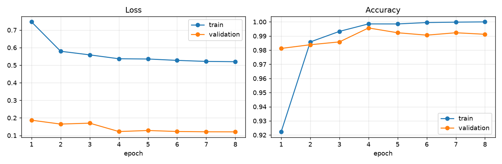
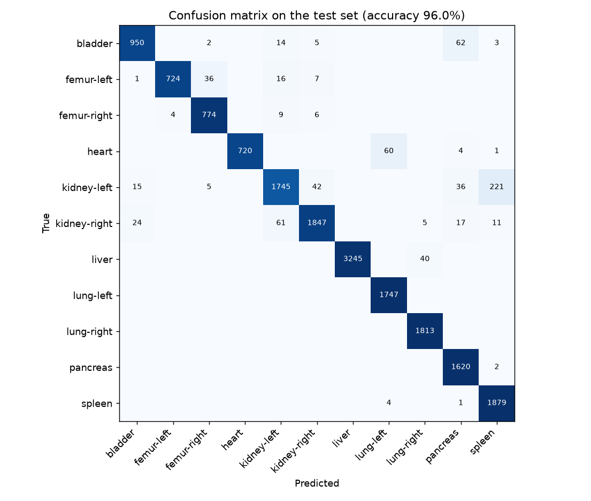

# Doctor vs AI

**Can you identify organs in a CT scan better than a neural network?**

A Streamlit game built on a ResNet18 that classifies 11 abdominal organs in real CT scans with **96.0% test accuracy**.
You and the model look at the same scan, both make a call, and the scoreboard shows who knows anatomy better.




---

## Contents
- [Features](#features)
- [Results](#results)
- [How it works](#how-it-works)
- [Run it locally](#run-it-locally)
- [Train the model yourself](#train-the-model-yourself)
- [Deploy](#deploy-on-streamlit-community-cloud)
- [Project structure](#project-structure)
- [Limitations](#limitations)
- [References](#references)

---

## Features

| | |
|---|---|
| **Play: Doctor vs AI**<br>10 rounds against the model. +10 points per correct answer, +5 bonus for every 3-in-a-row streak. Easy mode (4 choices) or Hard mode (all 11 organs). There's a study guide with one example per organ and a leaderboard at the end. |  |
| **Where is the AI looking?**<br>Grad-CAM heatmaps on random test scans show which region of the image drove the prediction. |  |
| **Upload & Predict**<br>Upload any image and get a prediction, the top-5 probabilities and a Grad-CAM overlay. Colour photos and low-confidence inputs get a warning. Below 40% confidence, the model says it doesn't know. |  |
| **AI Report Card**<br>Test accuracy, macro F1, training curves, confusion matrix and per-organ precision, recall and F1. |  |

---

## Results

Evaluated on the official OrganAMNIST test split (17,778 images, never seen during training).

| Metric | Value |
|---|---|
| Test accuracy | **95.98%** |
| Macro F1 | **0.957** |
| Best validation accuracy | 99.57% |
| MedMNIST v2 paper, ResNet-18 (28px / 224px) | 93.5% / 95.1% |

<p align="center">
  
</p>

<details>
<summary><b>Per-organ scores</b></summary>

| Organ | Precision | Recall | F1 | Test images |
|---|---|---|---|---|
| bladder | 0.960 | 0.917 | 0.938 | 1,036 |
| femur-left | 0.995 | 0.923 | 0.958 | 784 |
| femur-right | 0.947 | 0.976 | 0.961 | 793 |
| heart | 1.000 | 0.917 | 0.957 | 785 |
| kidney-left | 0.946 | 0.845 | 0.893 | 2,064 |
| kidney-right | 0.969 | 0.940 | 0.954 | 1,965 |
| liver | 1.000 | 0.988 | 0.994 | 3,285 |
| lung-left | 0.965 | 1.000 | 0.982 | 1,747 |
| lung-right | 0.976 | 1.000 | 0.988 | 1,813 |
| pancreas | 0.931 | 0.999 | 0.964 | 1,622 |
| spleen | 0.888 | 0.997 | 0.939 | 1,884 |

</details>

<p align="center">
  
</p>

The most common error is **left kidney predicted as spleen** (221 cases). Both organs sit on the patient's left side at a
similar height, so in a single 64×64 axial slice they can look very alike.

### Experiments (3 epochs each, same seed)

| Run | Test accuracy | Macro F1 | Seconds per epoch (T4) |
|---|---|---|---|
| Baseline (pretrained + AMP + augmentation) | 96.45% | 0.963 | 50.7 |
| Without mixed precision (FP32) | 96.53% | 0.963 | **138.5** |
| Trained from scratch | 94.87% | 0.946 | 56.7 |
| Without augmentation | 97.50% | 0.972 | 56.0 |

- **Mixed precision** made training **2.7× faster** with the same accuracy (174 ms vs 467 ms per step).
- **Transfer learning** from ImageNet added about 1.6 points over random initialisation.
- **Augmentation** did not help on this test set in a short run. The test slices have the same framing as the training
  slices, so the extra variation mostly slows convergence. Its value is robustness to shifted or rotated inputs rather
  than accuracy on clean data.

---

## How it works

**Dataset.** [OrganAMNIST](https://medmnist.com/) from MedMNIST v2 has 58,830 axial slices from abdominal CT scans in the
LiTS benchmark, each cropped around one of 11 organs. We use the 64×64 version with the official split:
34,561 train / 6,491 validation / 17,778 test. It is licensed CC BY 4.0.

**Model.** We fine-tune a ResNet18 pretrained on ImageNet. A standard ResNet shrinks a 64×64 input to a 2×2 feature
map, so we set the first convolution's stride to 1 and remove the max-pool layer. This keeps an 8×8 map at the last
block, which is better for both accuracy and Grad-CAM. The classifier head is replaced with a 512 → 11 linear layer.

**Training.**

| Setting | Value |
|---|---|
| Input | Grayscale → 3 channels, ImageNet normalisation |
| Augmentation | Random rotation ±10°, zoom ±10%, shift ±8% (no flips, since they would swap left and right organs) |
| Loss | Cross-entropy with label smoothing 0.1 |
| Optimiser | AdamW, lr 1e-3, weight decay 1e-4, One-Cycle schedule |
| Batch size / epochs | 128 / 8 |
| Precision | Mixed FP16 (`torch.autocast` + `GradScaler`) |
| Hardware | NVIDIA T4 (Google Colab), about 51 s per epoch |

**Explainability.** Grad-CAM averages the gradient of the predicted class over each feature map of `layer4` to get one
weight per channel. It then sums the weighted maps, applies ReLU and upsamples the result onto the scan.

---

## Run it locally

Requires Python 3.11 or newer.

```bash
git clone https://github.com/Pranjal02garg/doctor-vs-ai.git
cd doctor-vs-ai
python3 -m venv .venv
source .venv/bin/activate
pip install -r requirements.txt
streamlit run app.py
```

The trained weights (`artifacts/model.pt`) and the test images (`data/organamnist_64_test.npz`) are included, so the
app runs straight away.

---

## Train the model yourself

**Google Colab (recommended).** Open `OrganAMNIST_ResNet18_Training.ipynb` in
[Colab](https://colab.research.google.com/), select a T4 GPU (Runtime → Change runtime type), then Runtime → Run all.
The notebook walks through the full pipeline step by step:
1. Data exploration
2. Pre-processing and augmentation
3. Model setup
4. Training with mixed precision
5. Evaluation, the confusion matrix and misclassified examples
6. Grad-CAM
7. The experiments above

At the end it downloads `artifacts.zip`. Unzip it into the project folder.

**Command line.** Download the full dataset (200 MB) and run the training script:

```bash
curl -L -o data/organamnist_64.npz https://zenodo.org/api/records/10519652/files/organamnist_64.npz/content
python train.py                  # pretrained + AMP + augmentation
python train.py --no-amp         # FP32 for comparison
python train.py --no-pretrained  # from scratch
python train.py --no-aug         # without augmentation
```

---

## Deploy on Streamlit Community Cloud

1. Fork or push this repository to your GitHub account.
2. Go to [share.streamlit.io](https://share.streamlit.io) and choose **Create app**, then **Deploy a public app from GitHub**.
3. Select the repository, branch `main` and main file `app.py`.
4. Under **Advanced settings**, choose Python 3.12, then click **Deploy**.

`requirements.txt` installs the CPU-only build of PyTorch, which keeps the install small enough for the free tier.

---

## Project structure

```
.
├── app.py                                 Streamlit app (4 pages)
├── common.py                              Class names, model definition, data loading
├── train.py                               Command-line training + evaluation + AMP benchmark
├── OrganAMNIST_ResNet18_Training.ipynb    Full step-by-step training notebook (Colab)
├── requirements.txt
├── artifacts/
│   ├── model.pt                           Trained weights (ResNet18 state_dict, 45 MB)
│   ├── metrics.json                       Test metrics, confusion matrix, AMP benchmark
│   ├── history.json                       Per-epoch loss and accuracy
│   └── experiments/                       Results of the comparison runs
├── data/
│   └── organamnist_64_test.npz            Test split used by the app (61 MB)
└── docs/                                  Screenshots and figures for this README
```

---

## Limitations

- The model only knows 11 organs in cropped axial abdominal CT. For anything else, it still picks one of the 11 classes.
  The app warns on colour images and low-confidence predictions, but this is not real out-of-distribution detection.
- Images are 64×64, which is far below clinical resolution.
- The leaderboard is stored in a local JSON file, so it resets when a cloud deployment restarts.
- This is an educational project, **not a medical device**. Do not use it for diagnosis.

---

## References

1. J. Yang et al., "MedMNIST v2: A large-scale lightweight benchmark for 2D and 3D biomedical image classification," *Scientific Data*, 10, 41, 2023.
2. K. He, X. Zhang, S. Ren, J. Sun, "Deep Residual Learning for Image Recognition," CVPR 2016.
3. R. R. Selvaraju et al., "Grad-CAM: Visual Explanations from Deep Networks via Gradient-based Localization," ICCV 2017.
4. P. Micikevicius et al., "Mixed Precision Training," ICLR 2018.
5. P. Bilic et al., "The Liver Tumor Segmentation Benchmark (LiTS)," *Medical Image Analysis*, 84, 2023.

The OrganAMNIST data is distributed under CC BY 4.0. The test split included in this repository is unmodified apart
from being saved in a compressed format.

## License

The code is released under the [MIT License](LICENSE).
